# Muhammad Ahmed

Software Engineering student at Sindh Agriculture University, Tandojam, Pakistan. I build websites and web apps with AI tools — I plan, direct and test each build, and fix what doesn't work.

I'm looking for an internship or junior web work, remote or Hyderabad-based.

## Featured projects

- **MediLens** — photograph a medicine pack and get an explained red / amber / green screening verdict. A screening assistant, not a medical device. University Web Engineering project. [Repo](https://github.com/Muhammad-Ahmad-CO/medilens) · [Live site](https://medilens-ruddy.vercel.app/)
- **MediLens (hackathon version)** — the same idea rebuilt fresh as an MVP for the Meta Global AI Developer Hackathon. [Repo](https://github.com/Muhammad-Ahmad-CO/medilens-llama) · [Live site](https://medilens-llama.vercel.app)
- **My portfolio** — the source code of my portfolio site, and the live site itself. [Repo](https://github.com/Muhammad-Ahmad-CO/ahmadsportfolios) · [Live site](https://ahmadsportfolios.lovable.app/)
- **Hisab** — a voice money diary: speak your spending in Roman Urdu and the diary keeps itself. Early hackathon scaffold. [Repo](https://github.com/Muhammad-Ahmad-CO/hisab)
- **The Case of You** — a detective mystery written around you: one inn, five suspects, three cases. Built for #BuildHybridAI 2026 with Firebase AI Logic. [Repo](https://github.com/Muhammad-Ahmad-CO/case-of-you)
- **Thanos Cam** — an Android effects camera: a pinch gesture, tracked with MediaPipe, cycles video themes. [Repo](https://github.com/Muhammad-Ahmad-CO/thanos-cam)
- **Color Cover** and **T Roadster** — two games: a 2–4 player territory battle on one phone, and a 3D endless-runner driving game. [Color Cover repo](https://github.com/Muhammad-Ahmad-CO/color-clash) · [T Roadster repo](https://github.com/Muhammad-Ahmad-CO/T-roadster)

## What I work with

React, Next.js and Tailwind CSS, built with AI tools · Supabase · Vercel · GitHub · MediaPipe hand tracking · Three.js

## Contact

- Portfolio: https://ahmadsportfolios.lovable.app/
- Email: [ahmadkaimkhani40@gmail.com](mailto:ahmadkaimkhani40@gmail.com)

  

Contribution graph regenerates daily via GitHub Actions.
