<!--
  Muhammad Ahmad — GitHub profile README
  ============================================================
  This profile is a stack of animated SVG cards in cards/.
  They are generated by ONE script:  scripts/generate_cards.py
  A daily GitHub Action (.github/workflows/cards.yml) refreshes
  data/contributions.json, re-runs the script and commits the cards.
  Colours & fonts match https://ahmadsportfolios.lovable.app
  (#0C0C0C ink, #EDEFF2 paper, #BBCCD7 / #D7E2EA steel;
   Kanit, Space Grotesk, Inter — subset & embedded in each card).
  Preview the final frame locally:
    STATIC=1 OUT_DIR=preview/static python3 scripts/generate_cards.py
-->

  

  <a href="https://github.com/Muhammad-Ahmad-CO?tab=repositories"></a>
  <a href="https://github.com/Muhammad-Ahmad-CO"></a>
  <a href="https://ahmadsportfolios.lovable.app"></a>

  

  <a href="https://github.com/Muhammad-Ahmad-CO/al-fjrfoods"></a> 
  <a href="https://github.com/Muhammad-Ahmad-CO/ahmadsportfolios"></a> 
  <a href="https://github.com/Muhammad-Ahmad-CO/cement-zen"></a> 
  <a href="https://github.com/Muhammad-Ahmad-CO/monolithstudio"></a> 
  <a href="https://github.com/Muhammad-Ahmad-CO/hero-blossom-glow"></a> 
  <a href="https://github.com/Muhammad-Ahmad-CO/home-hearth-store"></a>

  

  <a href="https://ahmadsportfolios.lovable.app"><b>Portfolio</b></a> ·
  <a href="mailto:ahmadkaimkhani40@gmail.com"><b>Email</b></a> ·
  <a href="https://www.linkedin.com/in/muhammad-ahmed"><b>LinkedIn</b></a> ·
  <a href="https://instagram.com/ahmadkaimkhanii"><b>Instagram</b></a> ·
  <a href="https://twitter.com/mohammadahmadqk"><b>Twitter</b></a>

  Cards regenerate daily via <a href="https://github.com/Muhammad-Ahmad-CO/Muhammad-Ahmad-CO/actions/workflows/cards.yml">GitHub Actions</a> · Animations respect <code>prefers-reduced-motion</code> · Software Engineering student · Sindh Agriculture University, Tandojam

